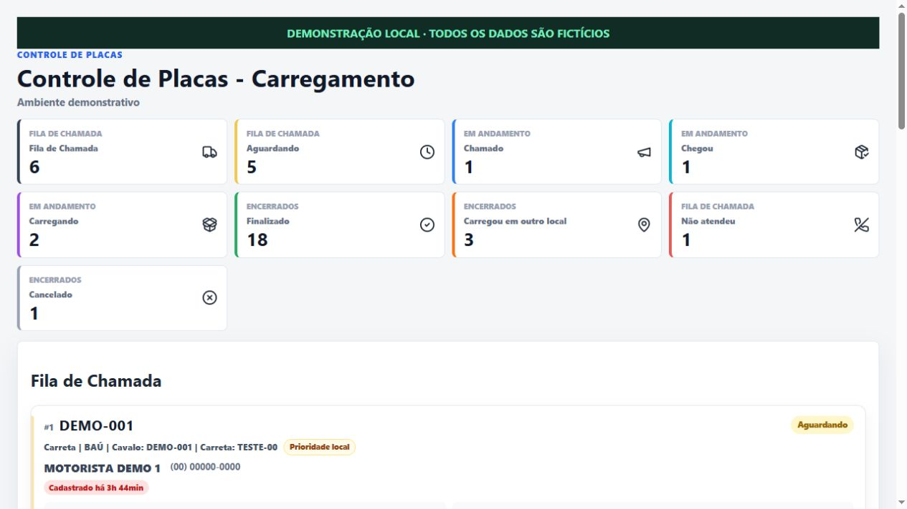
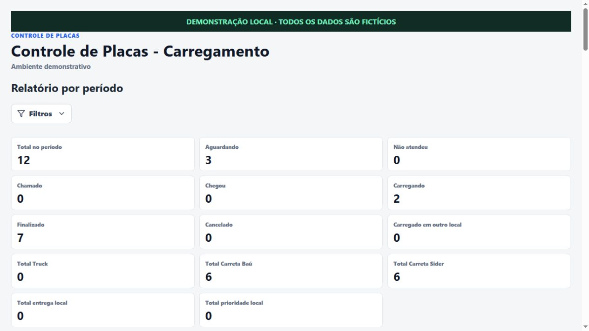

<p align="center"></p>

# Controle de Placas

Organização da fila de carregamento, acompanhamento de ligações e histórico das operações.

**React · Vite · Supabase**

[**🚚 Acessar o sistema**](https://controle-de-placas-carregamento.vercel.app) · [Instalação e configuração](docs/guia-configuracao.md) · [Mais projetos](https://github.com/igorcastro1010)

[](https://github.com/igorcastro1010/controle-de-placas-carregamento/actions/workflows/ci.yml)

## Funcionalidades em tela

Capturas de demonstração local com dados fictícios, preparadas em 22/10/2026. Não representam dados de produção. [Como foram produzidas](docs/capturas-demonstracao.md).

### Indicadores e fila de chamada



### Relatório por período



## Funcionalidades

- Fila e acompanhamento dos estados de cada veículo.
- Cadastro e bloqueio de placas duplicadas ativas.
- Atualização em tempo real com Supabase.
- Histórico, relatórios e ações por permissão.

## Começar

```powershell
npm ci
npm run dev
```

Configure o ambiente e o banco antes de usar o aplicativo. O workflow de CI verifica o build; ele não testa login, permissões nem o banco remoto.

## Documentação técnica

O [guia de configuração](docs/guia-configuracao.md) preserva as instruções anteriores de instalação, variáveis de ambiente, banco e publicação. A página inicial do repositório concentra a apresentação do produto.
